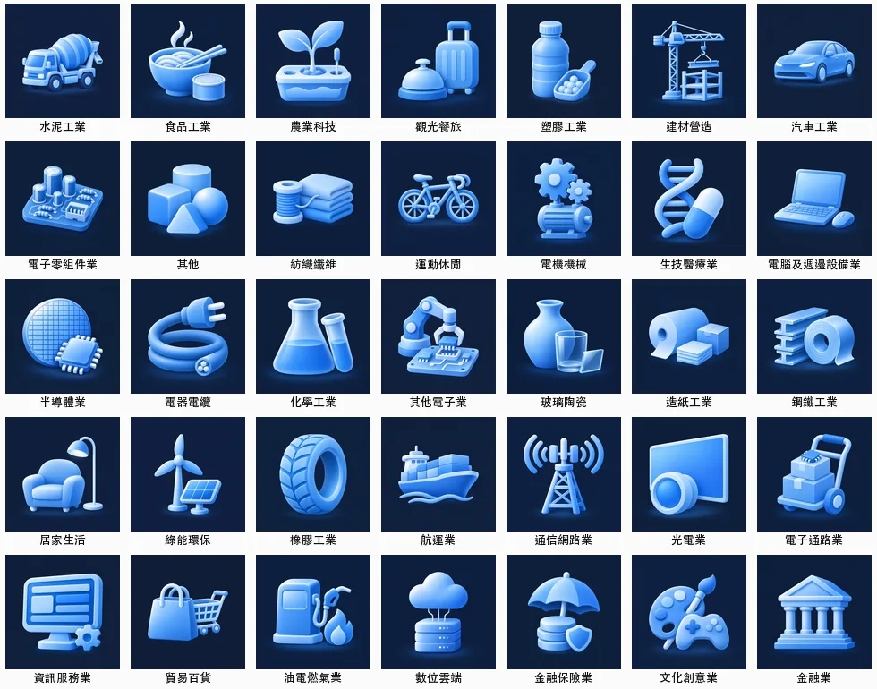

# 插圖素材（Codex 生圖）

2026-11-08 以 Codex CLI 內建 imagegen 產出。原創插圖，**畫面內沒有任何文字、數字、商標**——數字一律由程式（SVG → rsvg-convert）疊上去，AI 只負責畫底。



## 內容

| 路徑 | 內容 | 規格 |
|---|---|---|
| `industries/<slug>.webp` | 35 個產業的圖示插圖（對照表 `industries.tsv`：中文名、slug、主體描述） | 512×512、webp q82、深藏青底 |
| `rank-bg/{median,average,raise}.jpg` | 三個排行榜的分享卡背景；左側約 55% 留白給疊字 | 1200×630、jpg q88 |
| `raw-sources.tsv` | 每張最終圖對應的 Codex 原始輸出路徑（`~/.codex/generated_images/…`，1254px PNG，只存在本機） | — |
| `prompts/` | prompt 範本、4 張重生時改過的最終 prompt、風格參考圖 | — |
| `scripts/normalize.sh` | 偵測主體範圍 → 統一縮放到約 70% 並置中 → 512 webp | — |

尚未接進網站（`public/`）；目前只是素材。

## 品牌規則

- 底色 `#12203a`（排行榜背景 `#10182c`→`#132e4b`），主體 `#3987e5` 加淺色調 `#6ea8ee`、`#a9cdf7`，以及白色高光。不用紫色或彩虹光澤，也不用其他色相。
- 柔和 3D 圖示風格（霧面、圓角、輕微光暈），一個主體群組置中，縮到 48px 仍要認得出來。
- 不畫：文字、數字、公司 logo、旗幟、人臉、台灣地圖輪廓（AI 畫的形狀不準）、假的介面截圖。

## 重製步驟

```bash
# 1) 產圖：每張一個 codex exec，附風格參考圖（-i）讓 35 張畫風一致
#    註：~/.codex/config.toml 的預設模型若不在可用清單（2026-11-08 的 gpt-6.1-sol 即是），用 -m 指定
codex exec -m gpt-5.6-sol --skip-git-repo-check -s read-only --json \
  -i prompts/style-ref.png -o last.txt - < prompt.txt > run.jsonl
#    style-ref.webp 若不被 -i 接受，先 magick style-ref.webp style-ref.png
#    原始 PNG 會在 ~/.codex/generated_images/<thread_id>/exec-*.png（thread_id 取自 run.jsonl 的 thread.started）

# 2) 統一大小、置中、輸出 512 webp
FILL=0.70 scripts/normalize.sh <raw.png> industries/<slug>
```

prompt 結構：Use case／Asset type／Subject／Style／Constraints。產業圖的 Style 和 Constraints 兩段 35 張都相同，只換 Subject；完整範例見 `prompts/industry-template-example.txt`。

## 驗收紀錄

- 每張都由未參與生成的 verifier 以 512px 原尺寸逐張檢查：沒有文字、數字、商標；主體符合 `industries.tsv`；風格一致；48px 可分辨。
- verifier 標出 4 張並重生：運動休閒（線條太細）、光電業（玻璃反光太重）、橡膠工業（太飽和、過大）、電機機械（48px 糊掉）。改過的 prompt 在 `prompts/*-final.txt`。
- 已知但可接受：鋼鐵工業與造紙工業都是「捲筒＋疊片」構圖，電子零組件業與其他電子業都以電路板為底座；48px 仍可分辨。
